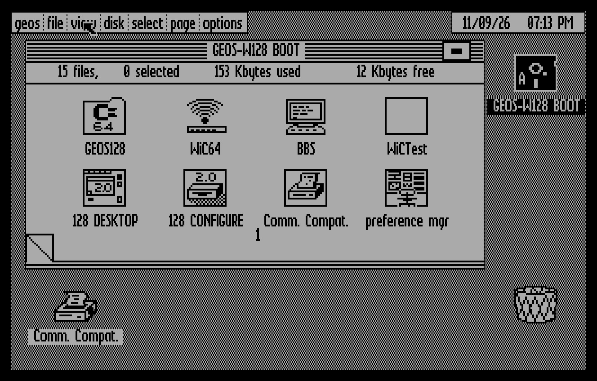
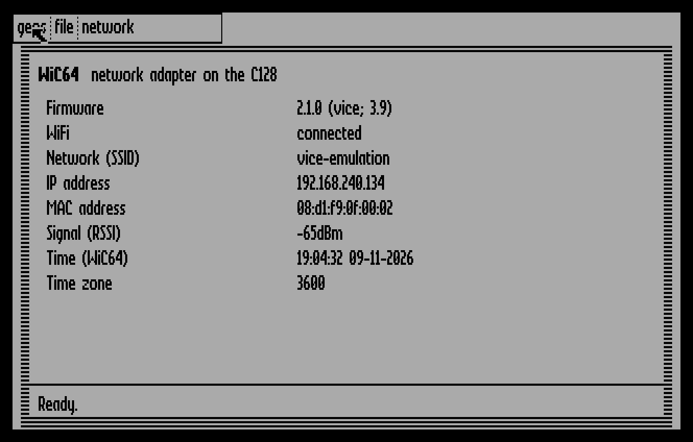
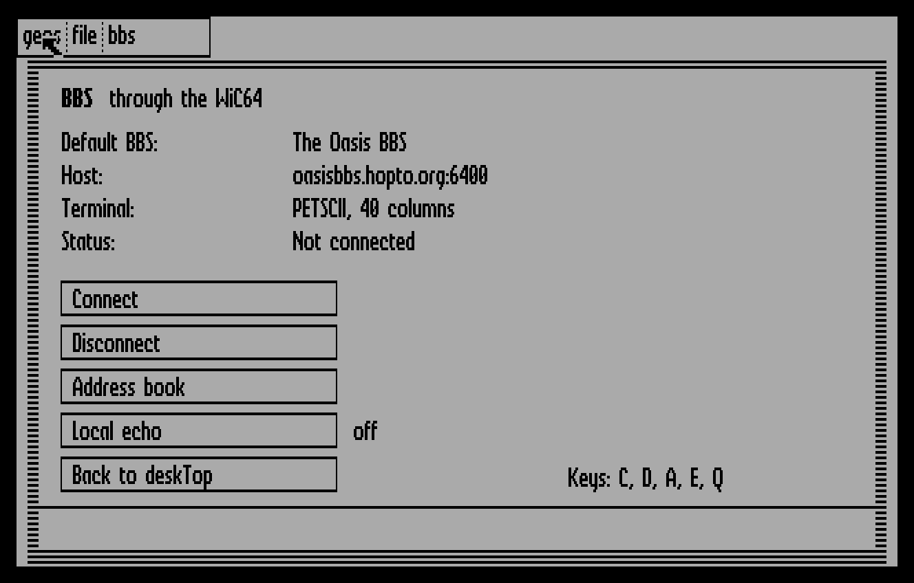
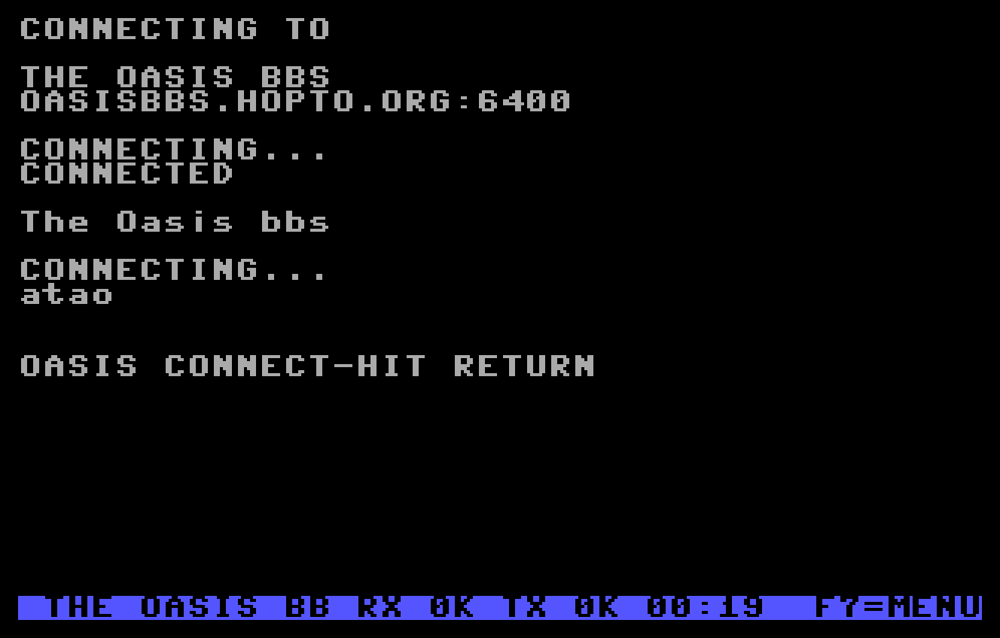
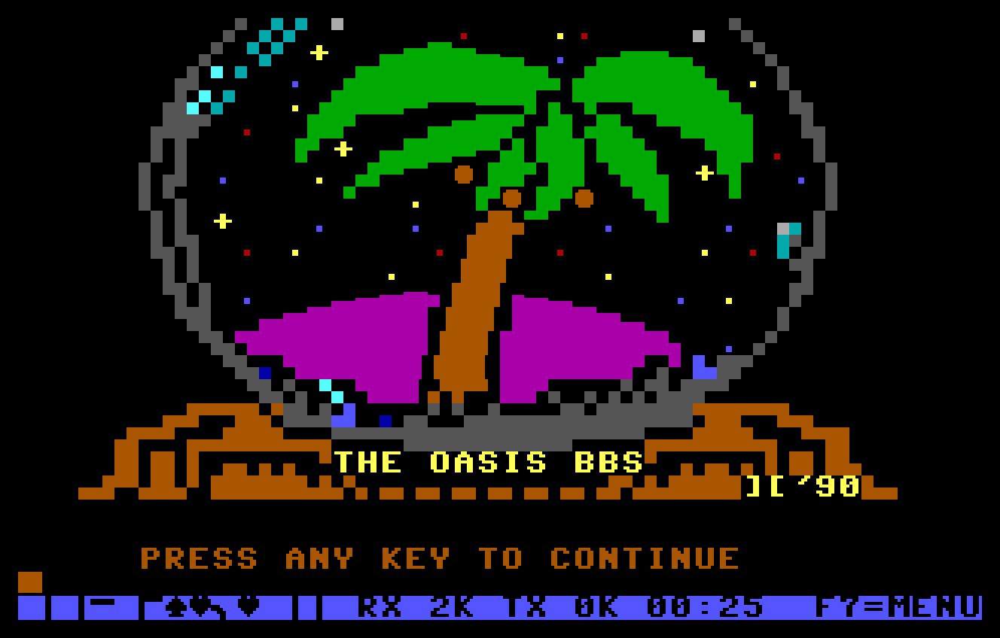
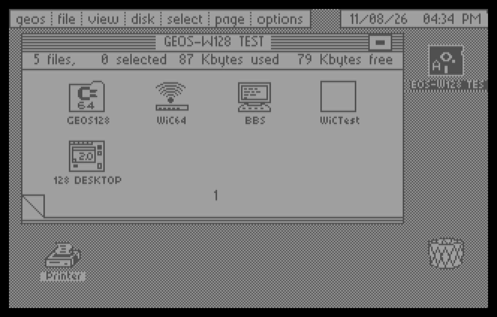

# GEOS-W128

**GEOS 2.0 running natively on the Commodore 128, on the internet through the WiC64.**

GEOS-W128 runs GEOS 2.0 in real C128 mode, not in C64 mode. It is built on the reconstructed GEOS 128 2.0 kernal from [mist64/geos](https://github.com/mist64/geos). It adds:
- the [WiC64](https://github.com/WiC64-Team) WiFi adapter;
- a clock that sets itself from the internet;
- a BBS terminal;
- disks for a stock C128D.

It runs on both screens: 80 columns at 2 MHz on the VDC, or 40 columns on the VIC.



## Screenshots

| | |
|---|---|
|  |  |
| **WiC64**: the network adapter's status, WiFi setup, time zone, and HTTP and TCP tests | **BBS**: a Telnet client with an address book |
|  |  |
| Connecting to a BBS through the WiC64 | Full colour PETSCII graphics in the terminal (The Oasis BBS) |



*The same system in 40 columns, for a monitor on the C128's normal video output.*

All screenshots were taken in VICE 3.9. GEOS-W128 has also run on a real Commodore 128D with a WiC64, in 80 columns.

## Features

| | |
|---|---|
| **Native C128** | Uses the MMU banking of the C128 and its second 64 KB bank. |
| **40 and 80 columns** | 80 columns: the VDC (640×200) at 2 MHz. 40 columns: the VIC (320×200) at 1 MHz. On the D64 disks the 40/80 DISPLAY key decides, as in the original GEOS 128. |
| **WiC64** | A driver that cc65 programs can link, plus three applications: WiC64, BBS and WiCTest. |
| **Clock** | At startup, GEOS takes the date and time from the WiC64. |
| **REU** | Detected at startup and handed to Configure, up to 512 KB. |
| **Input** | A 1351 mouse in port 1 and a joystick in port 1 or 2 work together, with no setup. |
| **Disk drives** | 1541, 1571 (also the C128D's built-in drive) and 1581, each with its own driver. |
| **5.25" disks** | The whole system on five D64 disks. They have a boot sector, so the C128 starts GEOS on power up. |

## Applications

### BBS

A Telnet BBS client:
- **Terminal:** a full screen colour terminal using the character ROM of the C128. PETSCII BBSes get 40 columns. ASCII BBSes get 80 columns on the VDC, or 40 on the VIC.
- **Telnet:** negotiates echo, binary mode, terminal type and window size.
- **Keyboard:** every key goes to the BBS as PETSCII, including colours and C= graphics. **F7** opens the session menu: hang up, XMODEM download, or back to deskTop.
- **XMODEM:** downloads go to disk with CRC or checksum, in 128 or 1024 byte blocks, and may be larger than memory.
- **Address book:** ten well known BBSes and six of your own, saved on disk.

### WiC64

Shows the firmware, WiFi status, network name, IP and MAC address, signal strength, time and time zone. From the *network* menu you can:
- connect to a WiFi network;
- set the time zone;
- test an HTTP request and a TCP connection.

### WiCTest

Checks your WiC64 with 23 tests:
- all status commands;
- blocks of up to 1000 bytes that must come back unchanged;
- an answer larger than the buffer;
- an error message;
- the time zone;
- a real TCP connection.

## Getting started

The [releases](https://github.com/mfidder2026/GEOS-W128/releases) contain disk images with the GEOS-W128 kernal and the three applications:

- `geos-w128-base.d64`: for a C128D, or a C128 with a 1571. The 40/80 DISPLAY key picks the screen. Start it with `RUN"GEOS128"`.
- `geos-w128-base.d81`: for a 1581 or a device that fully emulates one. Always 80 columns.

The original GEOS 128 programs, such as deskTop, geoWrite and geoPaint, are still under copyright, so they are not in this repository or in the releases. The release disks therefore stop at *"Please insert a disk with the 128 DESKTOP"*. To build a complete system from your own GEOS 128 2.0 disks, see [Building](#building).

**Which screen?** The 40/80 DISPLAY key is the locking key in the top row of the keyboard. The C128 reads it only at power up or reset:
- **Key up:** 40 columns, on the composite or S-video output. Any TV or composite monitor will do.
- **Key down:** 80 columns, on the RGBI output. This needs an RGBI monitor such as the Commodore 1084S or the Philips CM8802, or an RGBI adapter.

With the WiC64 on the user port, set up your WiFi once through the WiC64 portal, or in the WiC64 application under *network → connect to WiFi*.

## Building

You need [cc65](https://github.com/cc65/cc65), [VICE](https://vice-emu.sourceforge.io) (for `c1541`), [exomizer](https://bitbucket.org/magli143/exomizer) and Python 3. For a complete system you also need your own GEOS 128 2.0 system disks as D64 files in `disks/`.

```bash
python build.py w128 --format d64set    # five D64 disks, plus a boot disk for an external 1541
python build.py w128 --format d64test   # one boot disk: deskTop and the applications, always 40 columns
python build.py w128 --format d81       # one D81 disk, 80 columns
python build.py w128 --format d81 --base-only   # without the original GEOS files
```

The output goes to `build/w128/`. After every build, `build.py` checks the block chains of all GEOS files and the BAM. See [W128.md](W128.md) (in Dutch) for all details: the disk layout, the 40/80 column handling, the WiC64 driver API and the bugs fixed along the way.

## Status

Tested in VICE 3.9 with an emulated WiC64 and true drive emulation of the 1541, 1571 and 1581:
- booting from D81, D71 and D64;
- REU detection;
- the clock;
- WiC64 and WiCTest (23 of 23 passed);
- BBS against real BBSes and a local test BBS, including an XMODEM download with a damaged block.

All of this was tested in 40 and in 80 columns.

On a real Commodore 128D with a WiC64, these work in 80 columns:
- the deskTop;
- the WiC64 application;
- BBS, connected to The Oasis BBS.

Other parts have not been tested on real hardware yet.

## Credits

- GEOS was developed by Berkeley Softworks.
- The reverse engineered source is by Maciej Witkowiak and Michael Steil ([mist64/geos](https://github.com/mist64/geos)). Their original README follows below.
- GEOS-W128 builds on [GEOS-U64](ULTIMATE.md), GEOS for the Ultimate 64.
- The WiC64 is a project of the [WiC64 team](https://github.com/WiC64-Team).
- The welcome screen in the screenshot belongs to The Oasis BBS.

---

# GEOS Source Code

by Berkeley Softworks, reverse engineered by *Maciej Witkowiak*, *Michael Steil*.

## Description

[GEOS](https://en.wikipedia.org/wiki/GEOS_(8-bit_operating_system)) is a **graphical user interface for 6502-based computers**. In the 1980s, it was commercially available for the **Commodore 64**, 128 and Plus/4 as well as the Apple II.

GEOS has extremly low hardware requirements:

* a **MOS 6502**-compatible CPU (usually at 1 MHz or higher)
* **64 KB** of RAM
* one **disk drive** (capacity application-dependent)
* a **320x200** monochrome screen
* a **pointing device**

With just **20 KB** of binary code, the GEOS "KERNAL" has the following features:

* **Application Model**
	* One full screen application at a time
	* One "desk accessory" can be launched in a window while an application is running
	* Multi-segmented applications can be swapped in from disk
	* Runloop model
	* Cooperative multithreading
* **Graphical User Interface**
	* Menu bar with nested sub-menus
	* Dialog boxes
	* Buttons
	* Loadable proportional fonts at different sizes
	* Rich text rendering
	* Text input
	* Generic graphics drawing library supporting compressed images and fill patterns
* **Device Driver Interface**
	* Disk/storage
	* Mice
	* Printers
* **Other**
	* Multi-fork ("VLIR") file system API
	* External RAM extension support
	* Sprite library
	* Math library
	* Memory and strings library
	* Realtime clock with alarm

The default shell of GEOS is *deskTop*, a file manager and application launcher.

Several powerful applications are available for GEOS, including

* [geoWrite](https://github.com/mist64/geowrite)
* geoPaint
* geoPublish
* geoCalc
* geoFile
* geoBASIC

The [cc65](https://github.com/cc65/cc65) compiler suite allows writing GEOS applications in C or assembly.

## Source

This is the reverse engineered source code of the KERNAL (plus disk and input drivers) of the English version of GEOS 2.0 for Commodore 64 and Commodore 128.

The source has been heavily reorganized and modularized, nevertheless, a standard compile will generate binaries that are identical with the GEOS 64 2.0 and GEOS 128 2.0 distribution binaries.

Optionally, the following features that were not part of the original GEOS 2.0 can be enabled for GEOS64:

* gateWay 2.51 KERNAL patches
* +60K RAM support
* Ram Cart 64/128 support

## Requirements

* make, bash, dd
* [cc65](https://github.com/cc65/cc65) for assembling and linking
* [pucrunch](https://github.com/mist64/pucrunch) for generating a compressed executable
* [c1541](http://vice-emu.sourceforge.net) for generating the disk image

Without pucrunch/c1541, you can still build an uncompressed KERNAL binary image.

## Building

Run `make` to build the original "BSW" GEOS for C64. This will create the following files in directory `build/bsw`:

* raw KERNAL components: `kernal.bin`, `lokernal.bin`, `init.bin`
* disk drive drivers: `drv1541.bin`, `drv1541parallel.bin`, `drv1571.bin`, `drv1571burst.bin`, `drv1581.bin`
* input drivers: `amigamse.bin`, `joydrv.bin`, `lightpen.bin`, `mse1351.bin`, `koalapad.bin`, `pcanalog.bin`
* combined KERNAL image (`SYS 49155`): `kernal_combined.prg`
* compressed KERNAL image (`RUN`): `kernal_compressed.prg`
* disk image: `geos.d64`

If you have the [cbmfiles.com](http://www.cbmfiles.com/) `GEOS64.D64` image in the current directory, the disk image will be based on that one, with the `GEOS` and `GEOBOOT` files deleted and the newly built kernel added. Otherwise, it will be a new disk image with the kernel, and, if you have a `desktop.cvt` file in the current directory, with `DESK TOP` added.

## Variants

The build system supports the following variants:

* `bsw` (default): Berkeley Softworks GEOS 64 2.0 variant
* `cbmfiles`: The [cbmfiles.com](http://www.cbmfiles.com/) version. It starts out with a different date, and has some variables in the kernel pre-filled.
* `gateway`: The patched KERNEL shipped by gateWay 2.51. It contains a slightly modified BSW font, has the `Panic` code replaced with code to swap the disk driver on a RESTORE press, and it loads `GATEWAY` instead of `DESK TOP` as the shell.
* `wheels`: The Wheels 64 variant. It is heavily patched, optimized for size and speed, and contains additional features. It requires a RAM extension. The current version compiles into the same binary, but won't actually run because of missing boot code. More work is needed here.
* `bsw128`: Berkeley Softworks GEOS 128 2.0 variant, i.e. GEOS for C128 with 128 KB RAM and VDC 640px width support. This needs some more work to actually boot.
* `custom`: See below.

You can build a specific variant like this:

    make VARIANT=<variant>

All output will be put into `build/<variant>`.

## Drivers

By default, the KERNAL image will contain the Commodore 1541 disk driver (`drv1541`) and the joystick input driver (`joydrv`). You can specify different drivers to be included like this:

    make DRIVE=<drive> INPUT=<input>

Supported drives are `drv1541`, `drv1541parallel`, `drv1571` and `drv1581`. Supported input devices are `amigamse`, `joydrv`, `koalapad`, `lightpen`, `mse1351` and `pcanalog`.

For C128, with `VARIANT=bsw128` you can also choose to use `DRIVE=drv1571burst` to use native DOS Burst Command Instruction Set instead of speed loader.

## Customization

The KERNAL variant `custom` is meant for your experimentation. Inside the `.ifdef custom` section in `config.inc`, you can toggle several compile time options:

* `removeToBASIC = 1`: Don't include the ToBASIC code required for deskTop to launch non-GEOS applications, in order to save RAM for code.
* `use2MHz = 1`: Switch a C128 in C64 mode to 2 MHz outside of the visible screen.
* `usePlus60K = 1`: Enable support for the +60K RAM expansion.
* `useRamCart64 = 1`, `useRamCart128 = 1`: Enable support for the [Ram Cart](https://github.com/ytmytm/c64-ramcart128) expansion. 

With RAM expansion support, GEOS will use the extra RAM for caching deskTop and for holding the swap area when running desk accessories. GEOS will show an error at startup and reset the system if support for a particular memory expansion is enabled but it is not available.

Note that the changing settings and adding code may cause certain memory areas to overflow. In this case, you can try moving segments between the `LOKERNAL` and `KERNAL` areas. The file `kernal.map` in the build output will give you an idea about the sizes of segments. The `custom` variant starts out with about 550 bytes of usable memory in the `KERNAL` area.

## Source Tree

* `Makefile`
* `config.inc`: kernel config options
* `regress.sh`: script that compares output with reference
* `drv/`: disk drive driver source
* `inc/`: include files: macros and symbols
* `input/`: input driver source
* `kernal/`: kernal source
* `reference/`: original binaries from the cbmfiles.com version

## Hacking

### Code layout

Great care was taken to split the KERNAL into small, independent components. This division does not necessarily match the layout of the original binary code, but with the help of `.segments`, the layout in the binary does not have to match the layout in source.

The goal of this division of the source was to keep the number of `.imports` minimal (i.e. to make individual source files as self-contained and independent as possible).

One example of this is the file system and application/accessory loading code. In the original GEOS KERNAL binary, they were not separate, but here, the file system code is in `filesys.s` and the loading code is in `load.s`, with only two symbol dependencies.

Another example is the `ToBasic` logic: In the original kernel, it the binary code was split, a part resided between the header and the jump table ($C000-$C0FF), and different part was in the "lokernal" area ($9000-$9FFF). In the source, both parts are in the same file `tobasic.s`.

### Machine-specific Code

In case you want to adapt the source for other 6502-based systems, you will want to know which parts have C64 dependencies.

All C64-specific code can be easily recognized: Since all C64 symbols have to be imported from `c64.inc`, you can tell which source files have C64 depencency by looking for that include. Remove the include to see which parts of the code are platform-specific.

`InitTextPrompt` in `conio.s`, for example, accesses sprites directly, in the middle of hardware-independent code.

### Memory Layout

The GEOS KERNAL has a quite complicated memory layout:

* $9000-$9FFF: KERNAL ("lokernal")
* $A000-$BF3F: (graphics bitmap)
* $BF40-$BFFF: KERNAL
* $C000-$C01A: KERNAL Header
* $C01B-$C0FF: KERNAL
* $C100-$C2E5: KERNAL Jump Table
* $C2E6-$FFFF: KERNAL

The header and the jump table must be at $C000 and $C100, respectively. Together with the graphics bitmap at $A000, this partitions the KERNAL into four parts: lokernal, below header, between header and jump table, and above jump table.

The linker config file positions the segments from the source files into these parts. If the code of any segment changes, the header and the jump table will remain at their positions. If a part overruns, the linker will report and error, and you can consult the `kernal.map` output file to find out where to best put the extra code.

But it gets more complicated: Code between $D000 and $DFFF is under the I/O registers, so it cannot enable the I/O area to access hardware. The macro `ASSERT_NOT_BELOW_IO` makes sure that the current code is not under the I/O area. Existing code uses this macro just befor turning on the I/O area and just after turning it off. New code should use this macro, too.

### Naming Conventions

* Symbols used outside of the current source file are supposed to be prefixed with an `_`. (This hasn't been done consistently yet.)
* Labels that are only used within a subroutine should use the `@` notation.

### Copy protection

The original GEOS was copy protected in three ways:

* The original loader [decrypted the KERNAL at load time](http://www.root.org/%7Enate/c64/KrackerJax/pg106.htm) and refused to do so if the floppy disk was a copy. Like the cbmfiles.com version, this version doesn't use the original loader, and the kernel is available in plaintext.
* deskTop assigned a random serial number to the kernel on first boot and keyed all major applications to itself. This version comes with a serial number of 0x58B5 pre-filled, which matches the cbmfiles.com version.
* To counter tampering with the serial number logic, the KERNAL contained [two traps](http://www.pagetable.com/?p=865) that could sabotage the kernel. The code is included in this version, but can be removed by setting trap = 0.

## Contributing

Pull requests are greatly appreciated. Please keep in mind that a default build should always recreate the orginal binaries, so for smaller changes use conditional assembly using `.if`, and for larger changes create new source files that are conditionally compiled.

The following command line will build the `bsw` and `wheels` variants of GEOS and compare the resulting binaries with reference binaries:

    make regress

## TODO

* Reconstruction/cleanup:
	* complete inline documentation of KERNAL calls
	* `boot.s` should be based on the original GEOS version
	* REU detection is missing from `boot.s`
	* The 1541 driver is hardcoded. We should create one version per drive.
	* Some of Maciej's original changes/improvements have bitrotten and need to be resurrected
	* Wheels
		* The Wheels variant needs boot code to start up correctly.
		* The additional Wheels code needs to be reverse engineered properly.
* Integrate other versions as compile time options
	* Localized versions
	* Plus/4 version
	* C128 version (includes 640px support, linear framebuffer graphics, new APIs)
	* Apple II version (includes new APIs)
* Integrate existing patches as compile time options
	* megaPatch
	* SuperCPU
	* Flash 8
	* [misc](http://www.zimmers.net/anonftp/pub/cbm/geos/patches/index.html)
* Add third party disk drivers
	* CMD hardware
	* Modern hardware
* Optimizations
	* Faster (with size tradeoff) `font.s` and `graph.s` code
	* Alternate code paths for 65C02, 65CE02, 65816
* Extensions
	* upgrade `DlgBox` to support more than 16 files
	* support +60K and RamCart simultaneousy (hell!)
	* support swapping KERNAL modules to/from expansion
	* disk cache (at least dir cache) (hell!)
	* try to rewrite 1571/81 to use burst commands instead of turbodos (only on
  burst-enabled C64/128 in C64 mode - see Pasi Ojala's design)
* Reverse-engineer other components, like deskTop
* Port to new systems. :)

## References

* Farr, M.: [The Official GEOS Programmer's Reference Guide](http://lyonlabs.org/commodore/onrequest/The_Official_GEOS_Programmers_Reference_Guide.pdf) (1987)
* Berkeley Softworks: [The Hitchhiker's Guide to GEOS](http://lyonlabs.org/commodore/onrequest/geos-manuals/The_Hitchhikers_Guide_to_GEOS.pdf) (1988)
* Boyce, A. D.; Zimmerman, B.: [GEOS Programmer's Reference Guide ](http://www.zimmers.net/geos/docs/geotech.txt) (2000)
* Zimmerman, B.: [The Commodore GEOS F.A.Q.](http://www.zimmers.net/geos/GEOSFAQ.html)

## License

For the underlying work on GEOS, please respect its license.

The intellectual property added by the reverse-engineering and the subsequent improvements is in the public domain, but the authors request to be credited.

## Authors

GEOS was initially developed by Berkeley Softworks in 1985-1988.

The original reverse-engineering was done by [Maciej  'YTM/Elysium' Witkowiak](mailto:ytm@elysium.pl) in 1999-2002, targeted the ACME assembler and was released as [GEOS 2000](https://github.com/ytmytm/c64-GEOS2000), which included several code optimizations and code layout differences.

In 2015/2016, [Michael Steil](mailto:mist64@mac.com) ported the sources to cc65, reconstructed the original code layout, did some more reverse-engineering and cleanups, and modularized the code aggressively.
